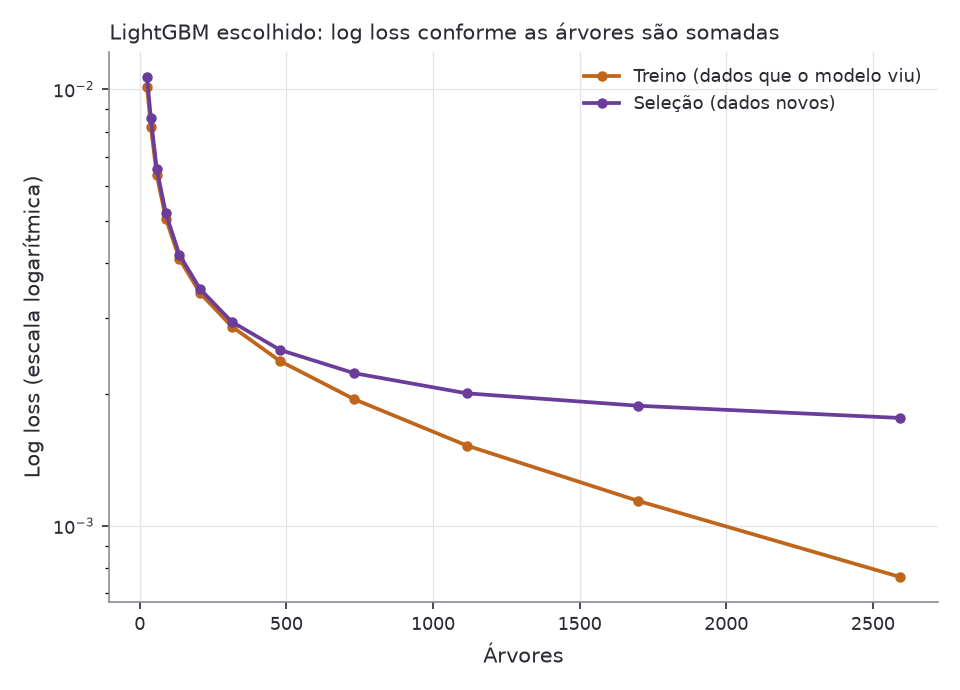
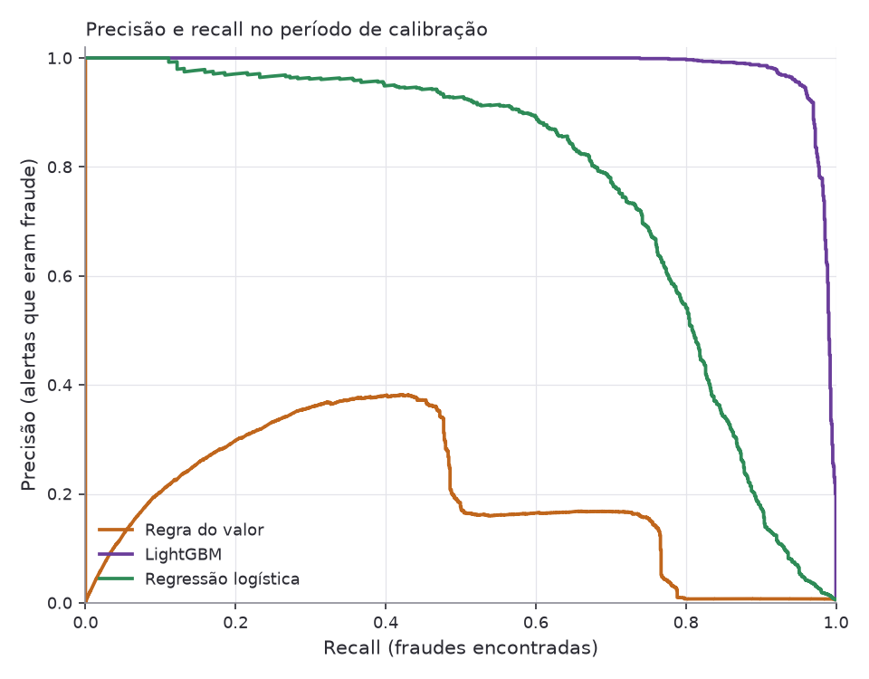
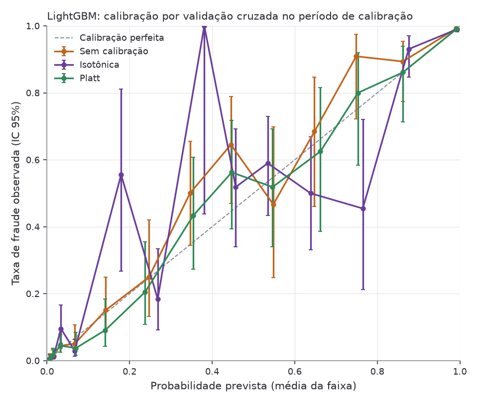
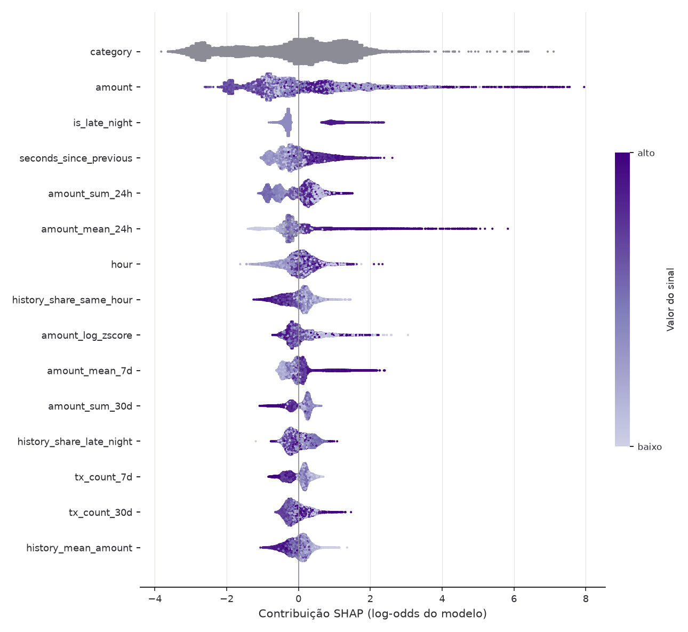

# Seleção do modelo (fase 4, antes do teste)

Gerado por `python -m pipeline.train` em 16/11/2026 às 13:19 (UTC). Usa só o `fraudTrain.csv`: o `fraudTest.csv` não foi aberto. Este relatório registra as escolhas que a avaliação única no teste (`python -m pipeline.evaluate`) vai medir. As decisões D12 a D20 de [`docs/decisoes-tecnicas.md`](../docs/decisoes-tecnicas.md) explicam cada uma.

Os dados são simulados e os custos são hipóteses: os números servem para comparar estratégias, não como estimativa de um negócio real.

## Dados

Os três conjuntos vêm do `fraudTrain.csv`, em ordem de tempo (decisão D12). A validação da fase 3 foi cortada em 01/04/2020: a primeira parte escolhe os modelos e a segunda, que nunca participa dessa escolha, calibra as probabilidades e define os limites.

| Conjunto | Período | Transações | Fraudes | Taxa de fraude | Uso |
|---|---|---:|---:|---:|---|
| Treino | 01/01/2019 a 31/12/2019 | 924.850 | 5.220 | 0,56% | ajuste de todos os modelos |
| Seleção | 01/01/2020 a 31/03/2020 | 172.843 | 1.123 | 0,65% | parada antecipada e escolha dos hiperparâmetros |
| Calibração | 01/04/2020 a 21/06/2020 | 198.982 | 1.163 | 0,58% | calibradores, comparação dos modelos e limites de decisão |

## Modelos de referência

### Regra do valor

Sinaliza a transação quando o valor é pelo menos **X = 713,69**. X é o corte com o maior F1 no treino (2019): o F1 pesa igualmente precisão e recall e não depende de hipóteses de custo. A regra é fixada sem olhar a validação.

| Conjunto | Sinalizadas | Fraudes identificadas | Falsos positivos | Precisão | Recall | F1 |
|---|---:|---:|---:|---:|---:|---:|
| Treino | 6.293 | 2.322 | 3.971 | 36,9% | 44,5% | 40,3% |
| Seleção | 1.210 | 504 | 706 | 41,7% | 44,9% | 43,2% |
| Calibração | 1.398 | 520 | 878 | 37,2% | 44,7% | 40,6% |

### Regressão logística

Sinais de cauda longa em log (valores, contagens e tempo desde a compra anterior), ausentes imputados pela mediana do treino com um indicador de ausência, padronização, categoria, hora e dia da semana em one-hot e regularização L2. Seis combinações de C e de peso das classes; vence a de maior PR-AUC (average precision) no período de seleção.

| C | Peso das classes | Iterações | PR-AUC treino | PR-AUC seleção | Tempo |
|---:|---|---:|---:|---:|---:|
| 0,01 | nenhum | 58 | 0,7455 | 0,7880 | 29 s |
| 0,01 | balanceado | 129 | 0,4969 | 0,6780 | 31 s |
| **0,10** | nenhum | 58 | 0,7511 | **0,7945** | 16 s |
| 0,10 | balanceado | 83 | 0,4780 | 0,6726 | 20 s |
| 1,00 | nenhum | 42 | 0,7470 | 0,7933 | 13 s |
| 1,00 | balanceado | 87 | 0,4765 | 0,6721 | 21 s |

**Escolhida:** C = 0,10, peso das classes nenhum.

## Modelo principal: LightGBM

Taxa de aprendizado 0,05; 80% das linhas e das colunas sorteadas por árvore; sem SMOTE, sem outra reamostragem e sem peso extra para as fraudes (decisão D14). O controle do sobreajuste é explícito:

- **parada pelo log loss** dos dados de validação, depois de 100 rodadas sem melhora: ele piora assim que o modelo fica confiante demais em dados novos;
- **busca só de regularização:** folhas por árvore, mínimo de transações por folha e penalidade L2;
- **validação cruzada temporal:** cada configuração é treinada e medida em quatro janelas; em cada uma, aprende com os meses anteriores e é medida nos seguintes;
- **regra de um erro padrão:** entre as configurações cuja PR-AUC média fica a no máximo um erro padrão da melhor, vence a mais simples (menos folhas, depois mais transações por folha, depois mais L2).

### Janelas da validação cruzada

| Janela | Treino | Validação | Transações de treino | Transações de validação | Fraudes na validação |
|---|---|---|---:|---:|---:|
| jul-ago 2019 | 01/01/2019 a 30/06/2019 | 01/07/2019 a 31/08/2019 | 400.004 | 173.955 | 713 |
| set-out 2019 | 01/01/2019 a 31/08/2019 | 01/09/2019 a 31/10/2019 | 573.959 | 139.410 | 872 |
| nov-dez 2019 | 01/01/2019 a 31/10/2019 | 01/11/2019 a 31/12/2019 | 713.369 | 211.481 | 980 |
| jan-mar 2020 | 01/01/2019 a 31/12/2019 | 01/01/2020 a 31/03/2020 | 924.850 | 172.843 | 1.123 |

### Configurações

| Folhas | Mín. por folha | L2 | PR-AUC média ± erro padrão | Log loss médio | Validação ÷ treino | Árvores (média) | Tempo |
|---:|---:|---:|---:|---:|---:|---:|---:|
| 7 | 300 | 1 | 0,9760 ± 0,0058 | 0,00217 | 3,2× | 1.648 | 3,1 min |
| 7 | 300 | 10 | 0,9760 ± 0,0057 | 0,00215 | 2,5× | 2.091 | 4,6 min |
| 7 | 1.000 | 1 | 0,9753 ± 0,0061 | 0,00220 | 2,9× | 1.554 | 4,1 min |
| **7** | 1.000 | 10 | **0,9764** ± 0,0055 | 0,00213 | 2,5× | 2.160 | 5,6 min |
| 15 | 300 | 1 | 0,9761 ± 0,0056 | 0,00219 | 4,6× | 824 | 2,7 min |
| 15 | 300 | 10 | 0,9767 ± 0,0055 | 0,00212 | 3,4× | 1.121 | 3,5 min |
| 15 | 1.000 | 1 | 0,9762 ± 0,0059 | 0,00218 | 4,7× | 856 | 2,5 min |
| 15 | 1.000 | 10 | 0,9762 ± 0,0056 | 0,00214 | 3,4× | 1.106 | 3,0 min |

*Validação ÷ treino* é quantas vezes o log loss em dados novos é maior que nos dados de treino, na média das janelas: quanto mais perto de 1, menos o modelo decorou.

A maior PR-AUC média é 0,9767; com o erro padrão, o limite da regra fica em 0,9711. **Escolhido:** 7 folhas, no mínimo 1.000 transações por folha, L2 = 10. O modelo final é o da última janela: treinado em todo o 2019, com parada no período de seleção, 2.592 árvores e PR-AUC de 0,9900 na seleção.

### Aprendizado e sobreajuste

Log loss e PR-AUC do modelo final no treino e no período de seleção, conforme as árvores são somadas:

| Árvores | Log loss treino | Log loss seleção | Seleção ÷ treino | PR-AUC treino | PR-AUC seleção |
|---:|---:|---:|---:|---:|---:|
| 25 | 0,01010 | 0,01067 | 1,1× | 0,8491 | 0,8680 |
| 38 | 0,00821 | 0,00857 | 1,0× | 0,8703 | 0,8879 |
| 58 | 0,00636 | 0,00657 | 1,0× | 0,9056 | 0,9191 |
| 89 | 0,00506 | 0,00520 | 1,0× | 0,9290 | 0,9399 |
| 135 | 0,00409 | 0,00418 | 1,0× | 0,9470 | 0,9563 |
| 206 | 0,00341 | 0,00348 | 1,0× | 0,9593 | 0,9674 |
| 314 | 0,00286 | 0,00293 | 1,0× | 0,9688 | 0,9756 |
| 479 | 0,00238 | 0,00253 | 1,1× | 0,9772 | 0,9812 |
| 731 | 0,00195 | 0,00224 | 1,1× | 0,9845 | 0,9850 |
| 1.115 | 0,00153 | 0,00201 | 1,3× | 0,9908 | 0,9876 |
| 1.700 | 0,00114 | 0,00188 | 1,7× | 0,9956 | 0,9891 |
| 2.592 | 0,00076 | 0,00177 | 2,3× | 0,9988 | 0,9900 |

No modelo final, o log loss em dados novos é 2,3× o do treino. Uma diferença perto de 1 indica que o modelo aprendeu padrões que se repetem, e não detalhes de cada transação do treino.

## Comparação dos três modelos

PR-AUC no período de seleção e, no período de calibração, que não participou da escolha dos hiperparâmetros: PR-AUC, recall com precisão de pelo menos 90%, qualidade das probabilidades finais (validação cruzada) e o resultado das decisões com os limites de cada modelo. A regra do valor manda para revisão tudo o que passa de 713,69.

| Modelo | PR-AUC seleção | PR-AUC calibração | Recall com precisão ≥ 90% | Brier | Log loss | Fraudes identificadas | Falsos positivos | Custo total |
|---|---:|---:|---:|---:|---:|---:|---:|---:|
| Regra do valor | 0,2121 | 0,1874 | não atinge a meta | — | — | 520 | 878 | 195.717 |
| Regressão logística | 0,7945 | 0,7685 | 58,3% | 0,00232 | 0,0106 | 1.008 | 2.309 | 69.355 |
| LightGBM | 0,9900 | 0,9849 | 97,0% | 0,00044 | 0,0018 | 1.137 | 286 | 6.374 |

Os limites da regressão logística e do LightGBM foram escolhidos neste mesmo período, então os custos acima são otimistas para os dois; a medida honesta virá do teste.

## Calibração

Cada método foi avaliado por validação cruzada no período de calibração: o período foi cortado em 5 blocos consecutivos e cada bloco foi previsto por um calibrador ajustado nos outros, para nenhum método ser medido nos dados em que foi ajustado (decisão D15). Vence o menor log loss; o Brier e o erro de calibração (ECE, diferença média entre previsto e observado por faixa) confirmam ou não.

| Modelo | Método | Brier | Log loss | ECE |
|---|---|---:|---:|---:|
| LightGBM | **Sem calibração** | 0,000443 | 0,00180 | 0,00014 |
| LightGBM | Platt | 0,000442 | 0,00184 | 0,00013 |
| LightGBM | Isotônica | 0,000454 | 0,00216 | 0,00024 |
| Regressão logística | **Sem calibração** | 0,002321 | 0,01064 | 0,00059 |
| Regressão logística | Platt | 0,002312 | 0,01065 | 0,00044 |
| Regressão logística | Isotônica | 0,002301 | 0,01088 | 0,00030 |

**Escolhida para o LightGBM: a probabilidade do próprio modelo, sem calibrador.** Ela errou menos em dados que não viu do que as duas calibrações, então um calibrador só acrescentaria uma peça sem melhorar a probabilidade.

Faixas de probabilidade (probabilidade do próprio modelo, sem calibrador, validação cruzada):

| Faixa prevista | Transações | Média prevista | Taxa observada | IC 95% |
|---|---:|---:|---:|---|
| 0,0% a 0,1% | 194.425 | 0,00% | 0,00% | 0,0% a 0,0% |
| 0,1% a 0,5% | 2.165 | 0,22% | 0,28% | 0,1% a 0,6% |
| 0,5% a 1,0% | 437 | 0,70% | 0,69% | 0,2% a 2,0% |
| 1,0% a 2,0% | 315 | 1,39% | 1,27% | 0,5% a 3,2% |
| 2,0% a 5,0% | 249 | 3,16% | 4,42% | 2,5% a 7,7% |
| 5,0% a 10,0% | 118 | 6,73% | 5,08% | 2,4% a 10,7% |
| 10,0% a 20,0% | 73 | 14,21% | 15,07% | 8,6% a 25,0% |
| 20,0% a 30,0% | 32 | 24,72% | 25,00% | 13,3% a 42,1% |
| 30,0% a 40,0% | 36 | 34,63% | 50,00% | 34,5% a 65,5% |
| 40,0% a 50,0% | 31 | 44,54% | 64,52% | 46,9% a 78,9% |
| 50,0% a 60,0% | 15 | 54,83% | 46,67% | 24,8% a 69,9% |
| 60,0% a 70,0% | 19 | 64,78% | 68,42% | 46,0% a 84,6% |
| 70,0% a 80,0% | 22 | 74,90% | 90,91% | 72,2% a 97,5% |
| 80,0% a 90,0% | 47 | 86,21% | 89,36% | 77,4% a 95,4% |
| 90,0% a 100,0% | 998 | 99,11% | 99,20% | 98,4% a 99,6% |

## Custos e limites de decisão

### Hipóteses de custo

Não há dados reais de custo para uma base simulada; os valores abaixo são hipóteses explícitas, na unidade dos valores da base (decisão D16):

| Situação | Custo | Tipo |
|---|---|---|
| Fraude aprovada | valor da transação | financeiro |
| Fraude bloqueada | 0 (a perda é evitada) | — |
| Fraude em revisão | 5 + 10% do valor (a revisão detecta 90%) | operacional e financeiro |
| Legítimo em revisão | 5 + 2 | operacional e experiência do cliente |
| Legítimo bloqueado | 25 | experiência do cliente e comercial |
| Legítimo aprovado | 0 | — |

Capacidade da equipe de revisão: no máximo 1% das transações. A análise de sensibilidade, mais abaixo, mostra o efeito de mudar cada hipótese.

### Limites escolhidos

- **Aprovar:** probabilidade de fraude menor que 0,0436;
- **Revisão humana:** de 0,0436 até antes de 0,2624;
- **Bloquear:** a partir de 0,2624.

Os dois limites minimizam o custo total no período de calibração, usando as probabilidades da validação cruzada e respeitando a capacidade de revisão. Comparação com outras estratégias, no mesmo período:

| Estratégia | Limite inferior | Limite superior | Aprovadas | Em revisão | Bloqueadas | Fraudes identificadas | Legítimos em revisão | Legítimos bloqueados | Custo financeiro | Custo operacional | Custo de experiência | Custo total |
|---|---:|---:|---:|---:|---:|---:|---:|---:|---:|---:|---:|---:|
| LightGBM: limites escolhidos, revisão até 1% | 0,0436 | 0,2624 | 197.559 | 243 | 1.180 | 1.137 | 222 | 64 | 3.115 | 1.215 | 2.044 | 6.374 |
| LightGBM: limites sem limite de capacidade | 0,0436 | 0,2624 | 197.559 | 243 | 1.180 | 1.137 | 222 | 64 | 3.115 | 1.215 | 2.044 | 6.374 |
| LightGBM: só bloquear a partir de 0,5 | 0,5000 | 0,5000 | 197.881 | 0 | 1.101 | 1.072 | 0 | 29 | 29.863 | 0 | 725 | 30.588 |
| Regressão logística: limites próprios, revisão até 1% | 0,0271 | 0,1255 | 195.665 | 1.984 | 1.333 | 1.008 | 1.860 | 449 | 44.490 | 9.920 | 14.945 | 69.355 |
| Regra do valor: revisar a partir de 713,69 | — | — | 197.584 | 1.398 | 0 | 520 | 878 | 0 | 186.971 | 6.990 | 1.756 | 195.717 |
| Aprovar tudo | — | — | 198.982 | 0 | 0 | 0 | 0 | 0 | 619.630 | 0 | 0 | 619.630 |

### Sensibilidade às hipóteses

Os limites procurados de novo sob cada hipótese, uma de cada vez:

| Hipótese | Limite inferior | Limite superior | Em revisão | Bloqueadas | Fraudes identificadas | Legítimos bloqueados | Custo total |
|---|---:|---:|---:|---:|---:|---:|---:|
| Hipótese base | 0,0436 | 0,2624 | 0,12% | 1.180 | 1.137 | 64 | 6.374 |
| Revisão custa 2 | 0,0436 | 0,2624 | 0,12% | 1.180 | 1.137 | 64 | 5.645 |
| Revisão custa 10 | 0,0436 | 0,1494 | 0,10% | 1.229 | 1.137 | 101 | 7.487 |
| Revisão custa 20 | 0,1494 | 0,1494 | 0,00% | 1.229 | 1.128 | 101 | 8.273 |
| Bloqueio indevido custa 10 | 0,0436 | 0,1494 | 0,10% | 1.229 | 1.137 | 101 | 5.002 |
| Bloqueio indevido custa 50 | 0,0436 | 0,2624 | 0,12% | 1.180 | 1.137 | 64 | 7.974 |
| Bloqueio indevido custa 100 | 0,0436 | 0,5756 | 0,17% | 1.088 | 1.137 | 21 | 9.728 |
| Revisão detecta 80% das fraudes | 0,0436 | 0,1494 | 0,10% | 1.229 | 1.137 | 101 | 6.861 |
| Revisão detecta todas as fraudes | 0,0436 | 0,6888 | 0,18% | 1.070 | 1.137 | 15 | 4.990 |
| Capacidade de revisão 0,5% | 0,0436 | 0,2624 | 0,12% | 1.180 | 1.137 | 64 | 6.374 |
| Capacidade de revisão 2% | 0,0436 | 0,2624 | 0,12% | 1.180 | 1.137 | 64 | 6.374 |
| Sem limite de capacidade | 0,0436 | 0,2624 | 0,12% | 1.180 | 1.137 | 64 | 6.374 |

## Explicações (SHAP)

Valores SHAP (TreeSHAP) calculados pelo próprio LightGBM numa amostra aleatória de 20.000 transações do período de calibração (decisão D19). A contribuição está em log-odds do modelo. A probabilidade final é uma função crescente desse escore, com ou sem calibrador, então um sinal que aumenta o escore também aumenta a probabilidade. A última coluna compara com a importância por ganho do próprio LightGBM.

| Posição | Sinal | SHAP absoluto médio | Participação | Posição por ganho |
|---:|---|---:|---:|---:|
| 1 | `category` | 1,236 | 16,2% | 3 |
| 2 | `amount` | 1,065 | 13,9% | 2 |
| 3 | `is_late_night` | 0,489 | 6,4% | 4 |
| 4 | `seconds_since_previous` | 0,452 | 5,9% | 14 |
| 5 | `amount_sum_24h` | 0,442 | 5,8% | 9 |
| 6 | `amount_mean_24h` | 0,432 | 5,7% | 1 |
| 7 | `hour` | 0,308 | 4,0% | 8 |
| 8 | `history_share_same_hour` | 0,294 | 3,8% | 11 |
| 9 | `amount_log_zscore` | 0,292 | 3,8% | 5 |
| 10 | `amount_mean_7d` | 0,267 | 3,5% | 7 |
| 11 | `amount_sum_30d` | 0,249 | 3,3% | 22 |
| 12 | `history_share_late_night` | 0,245 | 3,2% | 12 |

SHAP explica o modelo, não as causas no mundo real; sinais correlacionados dividem o crédito entre si (por exemplo, o valor e a razão entre o valor e a média do cartão).

### Exemplos individuais

Um caso típico de cada resultado no período de calibração, com os cinco sinais que mais pesaram. O texto vem do valor real do sinal; o número entre colchetes é a contribuição SHAP.

**Fraude bloqueada** (probabilidade 99,8%, decisão: Bloquear):

- Média das compras do cartão nas últimas 24 horas: 483,76 (aumentou o risco) [+5,21]
- Valor da compra: 18,03 (aumentou o risco) [+3,78]
- Compra na madrugada (22h às 3h59) (aumentou o risco) [+2,33]
- Média das compras do cartão nos últimos 7 dias: 163,87 (aumentou o risco) [+1,50]
- Soma das compras do cartão nas últimas 24 horas: 3.386,35 (aumentou o risco) [+1,30]

**Fraude enviada para revisão** (probabilidade 15,5%, decisão: Revisão humana):

- Média das compras do cartão nas últimas 24 horas: 713,80 (aumentou o risco) [+3,35]
- Valor da compra: 10,33 (aumentou o risco) [+2,18]
- Média das compras do cartão nos últimos 7 dias: 229,66 (aumentou o risco) [+1,95]
- Categoria do lojista: travel (aumentou o risco) [+1,42]
- Soma das compras do cartão nas últimas 24 horas: 4.996,62 (aumentou o risco) [+0,96]

**Cliente legítimo bloqueado** (probabilidade 98,1%, decisão: Bloquear):

- Valor da compra: 734,42 (aumentou o risco) [+7,09]
- Média das compras do cartão nas últimas 24 horas: 185,86 (aumentou o risco) [+2,83]
- Compra na madrugada (22h às 3h59) (aumentou o risco) [+2,16]
- Valor 2,7 desvios padrão acima do padrão de valores do cartão (aumentou o risco) [+1,86]
- Soma das compras do cartão na última hora: 1.686,05 (aumentou o risco) [+1,38]

**Cliente legítimo em revisão** (probabilidade 26,2%, decisão: Revisão humana):

- Valor da compra: 269,18 (aumentou o risco) [+6,35]
- Categoria do lojista: grocery_pos (aumentou o risco) [+2,67]
- Compra na madrugada (22h às 3h59) (aumentou o risco) [+1,44]
- 195 compras do cartão nos últimos 30 dias (aumentou o risco) [+1,10]
- Média das compras do cartão na última hora: 63,92 (reduziu o risco) [-0,94]

**Fraude aprovada** (probabilidade 3,9%, decisão: Aprovar):

- Valor da compra: 19,42 (aumentou o risco) [+3,89]
- Média das compras do cartão nas últimas 24 horas: 247,61 (aumentou o risco) [+2,86]
- 16,9 horas desde a compra anterior do cartão (aumentou o risco) [+1,31]
- Categoria do lojista: health_fitness (aumentou o risco) [+0,86]
- Soma das compras do cartão nas últimas 24 horas: 742,84 (aumentou o risco) [+0,59]

## Auditoria de equidade (desenvolvimento)

Gênero e faixa etária não entram no modelo; foram juntados às decisões do período de calibração só para comparar erros entre grupos (decisão D20). Os intervalos de 95% vêm de bootstrap por cartão, porque as transações de um mesmo cliente não são independentes. A avaliação definitiva será no teste.

### Gênero

| Grupo | Transações | Cartões | Fraudes | Taxa de fraude | Falsos positivos (IC 95%) | Fraudes não detectadas (IC 95%) | Precisão (IC 95%) | Legítimos bloqueados | Em revisão | Aviso |
|---|---:|---:|---:|---:|---:|---:|---:|---:|---:|---|
| Feminino | 108.799 | 467 | 594 | 0,55% | 0,17% (0,14% a 0,20%) | 3,5% (1,5% a 6,3%) | 75,8% (69,0% a 80,9%) | 0,04% | 0,15% |  |
| Masculino | 90.183 | 456 | 569 | 0,63% | 0,11% (0,09% a 0,14%) | 0,9% (0,2% a 1,9%) | 84,6% (79,5% a 88,5%) | 0,03% | 0,09% |  |

Diferenças entre grupos com pelo menos 30 fraudes cujo intervalo de 95% exclui zero (referência: Feminino):

- Masculino, taxa de falsos positivos: -0,05 pontos percentuais (-0,09 a -0,01)
- Masculino, fraudes não detectadas: -2,66 pontos percentuais (-5,43 a -0,24)
- Masculino, precisão: +8,76 pontos percentuais (1,77 a 16,69)
- Masculino, enviados para revisão: -0,05 pontos percentuais (-0,08 a -0,02)

São indícios para investigar, não prova de discriminação.

### Faixa etária

| Grupo | Transações | Cartões | Fraudes | Taxa de fraude | Falsos positivos (IC 95%) | Fraudes não detectadas (IC 95%) | Precisão (IC 95%) | Legítimos bloqueados | Em revisão | Aviso |
|---|---:|---:|---:|---:|---:|---:|---:|---:|---:|---|
| Até 29 anos | 35.703 | 147 | 184 | 0,52% | 0,19% (0,14% a 0,24%) | 0,0% (0,0% a 0,0%) | 73,3% (60,5% a 82,0%) | 0,04% | 0,15% |  |
| 30 a 44 anos | 67.042 | 270 | 297 | 0,44% | 0,14% (0,11% a 0,18%) | 5,7% (2,0% a 11,4%) | 75,1% (64,8% a 81,8%) | 0,04% | 0,12% |  |
| 45 a 59 anos | 52.442 | 265 | 326 | 0,62% | 0,13% (0,10% a 0,16%) | 1,8% (0,4% a 3,7%) | 82,9% (75,2% a 87,8%) | 0,02% | 0,11% |  |
| 60 anos ou mais | 43.795 | 254 | 356 | 0,81% | 0,14% (0,10% a 0,18%) | 0,8% (0,0% a 1,9%) | 85,5% (79,6% a 90,2%) | 0,03% | 0,12% |  |

Diferenças entre grupos com pelo menos 30 fraudes cujo intervalo de 95% exclui zero (referência: 30 a 44 anos):

- 60 anos ou mais, fraudes não detectadas: -4,88 pontos percentuais (-10,76 a -1,00)
- 60 anos ou mais, precisão: +10,41 pontos percentuais (1,58 a 22,10)
- Até 29 anos, fraudes não detectadas: -5,72 pontos percentuais (-11,44 a -2,03)

São indícios para investigar, não prova de discriminação.

## O que fica congelado para o teste

- **Modelo:** `models/fraud-detector/`, versão 1.0.0, LightGBM (probabilidade do próprio modelo, sem calibrador); assinatura do pacote `ea5832ca731b51763854c250af2e81099f081d0cafc19a6f133ea9698a9bcdaf`.
- **Limites:** revisão a partir de 0,0436, bloqueio a partir de 0,2624, com as hipóteses de custo acima.
- **Referências:** `models/baselines/`, assinatura `80011f9618292fa97166c5a44985cedb3ad02c2b8d0be7485c8305740d8e0a28`.
- **Meta de precisão:** recall com precisão de pelo menos 90%. Com essa precisão, no máximo um a cada dez alertas atinge um cliente legítimo, o nível em que um bloqueio automático ainda é defensável.
- **Leitura sim/não das decisões:** *alerta* é revisão ou bloqueio. Precisão, recall, F1 e matriz de confusão são calculados para o alerta e, à parte, para o bloqueio.
- **Métricas:** PR-AUC, precisão, recall, F1, matriz de confusão, Brier, log loss, ECE, fraudes identificadas, recall com precisão ≥ 90% e custos financeiro, operacional e de experiência com as hipóteses base; por mês e por categoria, com aviso para grupos com menos de 30 fraudes; equidade por gênero e faixa etária.
- **Procedimento:** `python -m pipeline.evaluate`, uma única vez. Ele confere as assinaturas abaixo antes de abrir o `fraudTest.csv` e se recusa a rodar de novo depois de gravar `models/test-evaluation.json`. Nada do teste volta para o modelo nesta fase.

| Arquivo | SHA-256 |
|---|---|
| `model.txt` | `8c67cfeca7a36236096c12c6e9a93ae2a16c2afb7e78f2b2c7d9a6c2f4c0f3d9` |
| `features.json` | `c2766415832523e86ee45e8cbbd5e11a05a47fdf4b7acb3c202fb6f6003e30cb` |
| `calibrator.json` | `0a7cdf0a3d2238b7af0f32d9fae7d441197f31e6303fba26d589c980034aeee6` |
| `decision.json` | `e7e807eef75cda40a71be919554a928ec37d0cd879853126b7143c1ebc84af08` |
| `metadata.json` | `a908ac5be91110c7cd912c25afdb2307689ed6d9cd9a8aaa4b4c5ca3d1074a11` |
| `baselines/amount-rule.json` | `a039aea13ad10329c9078b737cb52d9d625537aeb7022b3682b1bdff03173003` |
| `baselines/logistic.skops` | `80d0dd54edec8f7a5b0542b774da498235c94834d8915f002ff627edfca265dd` |
| `baselines/logistic.json` | `231ecc65d8fae4e157f61e31df6817698004bdf389127229d33355d5b8898aad` |

## Rastreamento

Experimento `payment-fraud-detection` no MLflow, execução `c0b018a39de7431e934265094600dad4` (com uma execução filha por configuração testada). Para abrir: `mlflow ui --backend-store-uri sqlite:///mlruns/mlflow.db`. Tempo total de desenvolvimento: 45,4 minutos.
